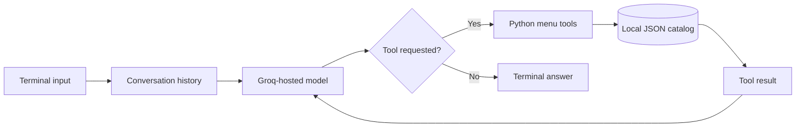

# Goer AI

**A conversational menu assistant that uses LLM tool calling to help customers discover food from local restaurants.**

Goer turns natural-language requests into searches over a structured restaurant catalog. Ask for a specific food, browse a merchant's menu, or follow up on an earlier recommendation. The model selects a tool, Python retrieves the menu data, and the results return to the model to compose an answer.

Originally built within **LocalGo**, Goer is now a standalone Python terminal prototype. This repository contains the existing assistant, its menu tools, and a bundled catalog of **138 products across two merchants**: Al-Taib and Château Kabab.

## What it does

- **Find food by name:** case-insensitive product-name search across the catalog, with optional merchant filtering.
- **Browse a restaurant:** retrieve a merchant's menu, including product IDs, categories, descriptions, and prices.
- **Handle follow-up questions:** keep conversation history in memory during the current session.
- **Choose tools dynamically:** let the model request `search_menu` or `get_menu`, then execute those functions locally.
- **Bound each conversation turn:** allow up to five model decisions per user message and configure a 30-second SDK timeout.

The system prompt instructs Goer to use catalog names and prices, display prices in CAD, and avoid inventing products. These are model instructions; responses are not independently validated. The catalog is a local snapshot, and listings do not establish live stock availability.

## How it works



| Component | Implementation |
| --- | --- |
| Runtime | Python 3.12 |
| Model | `openai/gpt-oss-20b`, accessed through the Groq Python SDK |
| Tool interface | JSON schemas describing each function and its arguments |
| Catalog | Local JSON with product IDs, merchant IDs, and integer prices in cents |
| Configuration | Environment variables loaded with `python-dotenv` |
| Conversation state | In-memory messages, including tool calls and their results |

The model interprets the request; Python performs catalog lookups. Each tool result is linked to its originating call using `tool_call_id`. This keeps retrieval logic separate from the conversational response and provides a small foundation for adding more tools.

## Run locally

You need **Python 3.12**, **Git**, and a **Groq API key** with access to the configured model. Internet access is required for model responses. No database, Supabase account, or web server is needed for this terminal prototype.

### 1. Clone and install

```bash
git clone https://github.com/samerodeh/goer-ai.git
cd goer-ai/backend
python3.12 -m venv .venv
source .venv/bin/activate
python -m pip install -r requirements.txt
```

On Windows PowerShell, create the environment with `py -3.12 -m venv .venv` and activate it with `.venv\Scripts\Activate.ps1`.

The dependency file is preserved from LocalGo and includes FastAPI, Uvicorn, and HTTPX alongside the chatbot's dependencies. Starting a FastAPI server is not part of this project's run procedure.

### 2. Configure the API key

From `backend/`, copy the environment template:

```bash
cp .env.example .env
```

On PowerShell, use `Copy-Item .env.example .env`.

Open `backend/.env` and set:

```dotenv
GROQ_API_KEY=your_groq_api_key_here
```

Only `GROQ_API_KEY` is required for Goer. The Supabase and other backend settings are inherited from LocalGo and can retain their template values. You can also provide the key as a process environment variable. `backend/.env` is ignored by Git; keep your real key there, never in the template.

### 3. Start the assistant

With the environment active and your working directory still set to `backend/`:

```bash
python -m app.goer
```

The terminal displays `json file loaded!` followed by a `You:` prompt. Try these requests in sequence:

```text
Find me a sandwich at Al-Taib.
Which of those is cheapest?
Show me the menu at Château Kabab.
```

Type `exit` or `quit` to end the session. Conversation history resets when the process exits.

### Check the catalog without an API call

From `backend/`, run:

```bash
python -c "from app.agent_tools.get_menu import get_menu; print(len(get_menu('al-taib')))"
```

This prints the catalog-loading message followed by `65`, the number of Al-Taib products. It does not require a Groq key or send a model request.

## Repository guide

```text
backend/
├── app/
│   ├── goer.py                 # Terminal loop, model requests, tool dispatch
│   ├── config.py               # Environment loading and shared settings
│   ├── agent_tools/
│   │   ├── search_menu.py      # Product-name search and tool schema
│   │   ├── get_menu.py         # Merchant menu retrieval and tool schema
│   │   └── menu_data.py        # Catalog loader used by get_menu
│   └── data/menu.json          # Bundled restaurant catalog
├── .env.example               # Configuration template
├── .python-version            # Python 3.12
└── requirements.txt           # Pinned dependencies
docs/
└── goer-agentic-architecture-plan.md
```

For a code review, start with [`goer.py`](backend/app/goer.py), then follow the two [menu tools](backend/app/agent_tools) and their function schemas.

## Current scope and next steps

The implemented experience covers **menu discovery in a terminal**. Cart management, checkout, payments, order tracking, a web API, and mobile integration are future work. There is no persistent conversation storage or automated test suite in this extracted repository.

Current limitations include substring-only search, unbounded conversation history, full menu results that can consume substantial model context, and no application-level recovery for provider errors or malformed tool arguments. Model requests send the conversation and retrieved menu results to Groq.

The [architecture plan](docs/goer-agentic-architecture-plan.md) describes the broader LocalGo roadmap, including context management, richer discovery tools, and eventual ordering workflows. It is a design document; planned capabilities are not implemented features of this repository.

## Troubleshooting

| Symptom | What to check |
| --- | --- |
| `No module named app` or missing `app/data/menu.json` | Run `python -m app.goer` from `goer-ai/backend`, not the repository root. |
| Missing `groq` or `dotenv` module | Activate `.venv` and install `requirements.txt` using that environment's Python. |
| Missing or rejected API key | Set a valid `GROQ_API_KEY` in `backend/.env` or the process environment. |
| Rate limit, timeout, or model-access error | Check your Groq account's access and limits. Wait before retrying; restart the program if it exits. |
| Long sessions exhaust context or token limits | Restart for a fresh conversation and use narrower food searches. |
