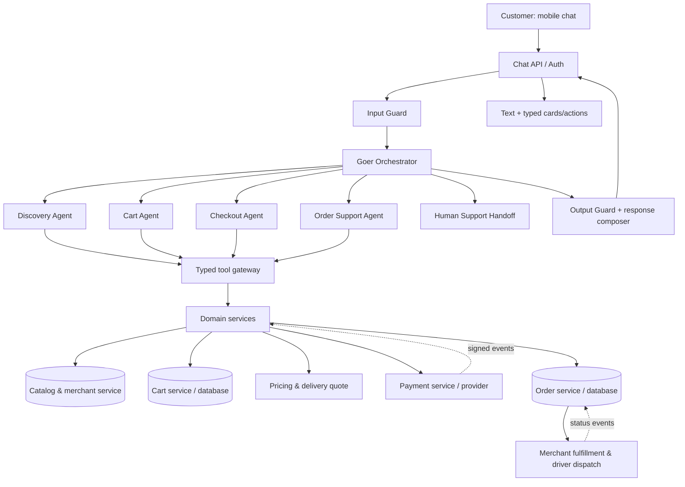
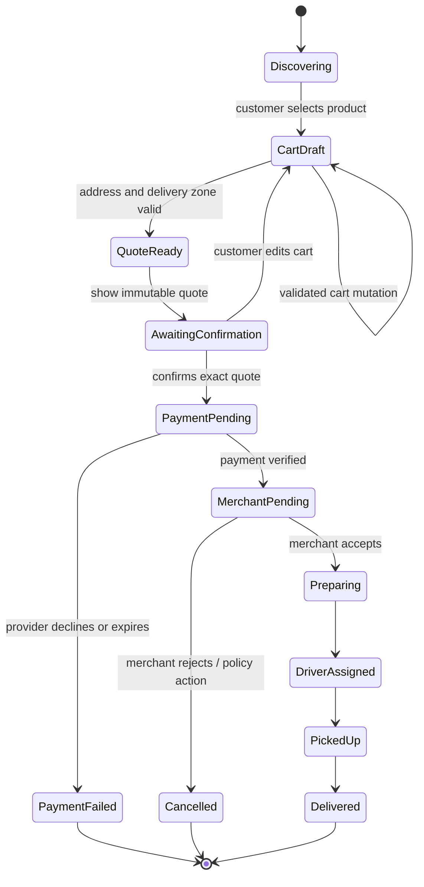

# Goer AI: Delivery Chatbot Agent Architecture

## Purpose

Define a practical architecture for Goer, LocalGo's conversational interface for restaurant discovery, ordering, checkout, and order support. The architecture should make the experience feel like one helpful assistant while keeping safety decisions, prices, payments, and order state under deterministic backend control.

This is a target architecture. The current Goer repository is a terminal prototype with one model-driven assistant and two menu tools (`search_menu` and `get_menu`) over a local JSON catalog. The specialized agents and delivery workflows below are proposed components, not claims about the current implementation.

## Design principles

1. **One assistant to the customer.** Goer is the consistent voice; internal agents are implementation details.
2. **Guard before and after orchestration.** Validate incoming requests, agent plans, tool arguments, and outgoing responses.
3. **Agents recommend actions; services perform them.** Domain services own catalog, cart, quote, payment, fulfillment, and order state.
4. **Never trust model memory for facts or mutations.** Read authoritative state from services and persist every successful mutation.
5. **Confirm consequential actions.** Require explicit confirmation of the exact quote before placing an order or starting payment.
6. **Structured UI events.** Return typed cards and actions alongside conversational text; never make the client parse prose to infer checkout state.
7. **Bounded and observable execution.** Limit routing depth, tool calls, tokens, latency, retries, and specialist handoffs.

## High-level architecture



## Agent roles

### 1. Guard agent (policy and safety gate)

Use a guard before orchestration and a final response check after it. It can be implemented as a small model check plus deterministic rules; it should not have domain mutation tools.

**Input checks:** authenticate user; enforce rate and size limits; detect prompt injection and requests outside supported scope; redact or block sensitive payment credentials; attach trusted account, locale, and conversation context.

**Execution checks:** permit only registered specialists and tool schemas; verify user ownership and authorization; reject malformed or out-of-scope tool calls; require confirmation tokens for consequential actions; apply policy rules to refunds, cancellation, age-restricted goods, and merchant availability.

**Output checks:** ensure claims about prices, stock, payment, and order status are backed by service results; remove secrets and unsafe content; verify that any card/action payload matches a valid schema and the current user's state.

The guard should return a structured decision such as `allow`, `clarify`, `deny`, or `handoff`, plus a reason code. It must fail closed for payment and order mutations.

### 2. Goer orchestrator agent

Owns conversation flow and delegates to specialists. It receives a compact state snapshot and allowed-action list, chooses the next specialist, and composes the final answer. It does not calculate prices, write orders, or call payment-provider APIs directly.

Responsibilities:

- Classify intent and identify missing details.
- Select one specialist per step; hand off only the minimum relevant context.
- Maintain the conversational thread while reading current cart/order state from services.
- Decide when to ask a clarification, show a card, or escalate to human support.
- Stop after configured limits and return a useful recovery response.

### 3. Discovery agent

Find merchants, categories, menu items, and product details. Uses catalog search, category listing, merchant availability, and product-detail tools. Recommendations must cite returned product IDs and facts; it cannot invent prices, dietary properties, or availability.

### 4. Cart agent

Explains and edits the user's active cart using `view_cart`, `add_item`, `change_quantity`, `remove_item`, and `clear_cart` operations. The cart service validates product IDs, option IDs, merchant consistency, quantities, and prices. The agent never edits cart state from conversation text alone and never computes totals.

### 5. Checkout agent

Collects delivery address, delivery instructions, tip, and other missing checkout inputs. Requests an authoritative quote and presents a quote card with a stable quote ID, line items, fees, taxes, total, currency, and expiration. After the customer confirms that exact quote, it requests order creation/payment initiation through backend services.

### 6. Order support agent

Retrieves active and historical orders, explains status based on order events, and offers only currently supported actions. Cancellation and refund eligibility come from backend policy/services. It may prepare a request, but cannot claim cancellation/refund completion without a successful service result.

### Optional specialists (add when product needs justify them)

- **Merchant selection agent:** helps compare restaurants, delivery zones, and hours.
- **Support handoff agent:** packages conversation and order context for a human agent.
- **Voice/transcription adapter:** converts speech to text and text to speech; it is a channel component, not an authority over order state.

Start with the core four specialists behind one orchestrator. Avoid separate deployed agent services until load, ownership, or independent release needs justify that complexity. A specialist can initially be a bounded prompt/tool configuration using the same model provider.

## Domain tools and service ownership

| Capability | Agent-facing tools | Source of truth |
|---|---|---|
| Discovery | `search_merchants`, `list_categories`, `search_menu`, `get_product` | Catalog and merchant service |
| Cart | `view_cart`, `add_item`, `update_item`, `remove_item`, `clear_cart` | Cart service and database |
| Checkout | `get_addresses`, `create_quote`, `confirm_quote`, `start_payment` | Address, pricing, quote, and payment services |
| Order support | `list_orders`, `get_order`, `get_cancellation_options`, `request_cancellation` | Order service and event history |

All tools should use typed inputs/outputs, authorization checks, idempotency keys for mutations, and explicit error codes. Tool results should be compact and include stable IDs. The backend—not a language model—validates and commits state transitions.

## Chat response contract for cards

Return a versioned response envelope rather than unstructured text alone:

```json
{
  "conversation_id": "...",
  "message": {"text": "Here are a few options.", "status": "complete"},
  "cards": [
    {"type": "product_list", "items": [{"product_id": "...", "name": "...", "price": {"amount": 12.5, "currency": "CAD"}}]},
    {"type": "cart_summary", "cart_id": "...", "revision": 4, "total": {"amount": 18.25, "currency": "CAD"}}
  ],
  "actions": [{"type": "add_to_cart", "label": "Add", "payload": {"product_id": "..."}}],
  "trace_id": "..."
}
```

Suggested card types: `merchant_list`, `category_list`, `product_list`, `product_detail`, `option_picker`, `cart_summary`, `address_picker`, `quote`, `payment_status`, `order_confirmation`, `order_tracking`, and `support_handoff`. The client should render only known card types and should submit actions to authenticated APIs; the model must never forge an authorization token or trusted card state.

## Delivery ordering lifecycle



Keep payment state, merchant fulfillment state, and delivery state as separate dimensions in persisted records and events. A driver assignment does not imply merchant acceptance, and a client-side payment callback does not prove payment succeeded.

## Persistence and reliability

Persist conversations and messages, agent runs and handoffs, tool-call audit records, cart revisions, quotes, payment attempts, orders, and order events. Store references and compact summaries in model context, not entire menus or long raw tool histories. Use conversation/user ownership checks on every read and mutation.

For mutations, use idempotency keys, transactional writes, and replay-safe event handling. If a request times out after the backend commits, retrieve the recorded outcome rather than repeating the operation. Use signed provider webhooks and reconciliation for payment truth. Keep sensitive payment details in the payment provider's secure UI/tokenization flow, not chat text or language-model context.

## Model and OpenAI SDK boundary

Keep the model behind a provider adapter. The adapter should expose a consistent interface for structured responses and tool calls while allowing provider/model changes through configuration. If using an OpenAI SDK, the application communicates through that SDK interface; the selected endpoint and model determine whether requests go to OpenAI or a compatible provider. Goer's current prototype uses the Groq Python SDK with `openai/gpt-oss-20b`, so describe it accurately as an OpenAI-compatible model served by Groq unless the integration is changed.

Use separate model settings by task if useful: a lower-latency classifier/guard check, a capable orchestrator, and constrained specialist calls. Start with a single capable model and distinct prompts/tools; split models only after evaluation shows a clear cost, latency, or quality benefit. Do not assume each specialist needs its own continuously running model or process.

## Security and privacy controls

- Authenticate every chat session and bind conversation, cart, address, and order IDs to the authenticated user.
- Treat user text, menu descriptions, retrieved records, and model output as untrusted input.
- Validate tool arguments against schemas and business rules; use allowlists for tools and destinations.
- Keep API keys and payment credentials out of prompts, logs, cards, and client bundles.
- Use least-privilege service credentials and scoped agent tools.
- Require explicit confirmation for quote acceptance and destructive actions; apply idempotency and audit logging.
- Enforce retention, deletion, and access rules for conversation data.
- Add abuse limits, prompt-injection evaluations, authorization tests, and monitoring for unusual tool behavior.

## Observability and evaluation

Attach a trace ID to each customer turn, model request, specialist handoff, tool call, and domain event. Record latency, token use, tool outcomes, guard decisions, retries, and state transitions while redacting sensitive data.

Evaluate task completion, intent routing, product resolution, unsupported claims, cart correctness, quote confirmation, duplicate mutations, payment recovery, cancellation behavior, response latency, and model cost. Include adversarial cases such as prompt injection in product descriptions, cross-user order IDs, ambiguous products, stale quotes, duplicate taps, and lost responses.

## Suggested implementation sequence

1. Keep the current Goer discovery flow, add bounded context, robust provider errors, and structured API responses.
2. Introduce authenticated chat endpoint, conversation persistence, catalog service contracts, and the input/output guard.
3. Add typed product cards and reliable catalog/category/product-detail tools.
4. Build backend-owned cart state and cart cards; validate every mutation server-side.
5. Add addresses, delivery-zone checks, immutable server quotes, and explicit quote confirmation.
6. Integrate tokenized payment flow, signed payment events, idempotency, and reconciliation.
7. Add canonical order state, merchant acknowledgment, driver dispatch, and tracking events.
8. Add order-support specialist, cancellation rules, human handoff, evaluations, monitoring, and gradual rollout.
9. Add more specialists or separate services only where measured product or operational needs justify them.

## Current versus proposed

**Implemented now:** one terminal Goer assistant; Groq Python SDK; `openai/gpt-oss-20b`; `search_menu` and `get_menu`; local JSON catalog; in-memory conversation messages; bounded model decisions per user turn.

**Proposed here:** input/output guard, orchestrator, discovery/cart/checkout/order-support specialists, authenticated API, structured cards, persistence, cart, quote, payment, order lifecycle, merchant/driver integration, observability, and human handoff. These should be described as architecture or roadmap until code and integrations implement them.
